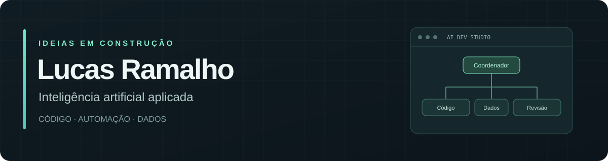

  

  <a href="https://github.com/lucasramalho28-max/ai-dev-studio">Conheça meu projeto</a> ·
  <a href="https://www.instagram.com/lucask22000/">Instagram</a> ·
  <a href="https://www.facebook.com/lucas.ramalho.12">Facebook</a>

## Olá, sou Lucas Ramalho 👋

Estou construindo ferramentas que aproximam inteligência artificial, desenvolvimento de software e análise de dados. Meu foco atual é transformar ideias em aplicações que possam ser acompanhadas, revisadas e testadas.

## Projeto em destaque

### [AI Dev Studio](https://github.com/lucasramalho28-max/ai-dev-studio)

Um ambiente de desenvolvimento para Windows com IA local via Ollama, editor de código e oito agentes especializados trabalhando em sequência.

| Recurso | Como funciona |
| --- | --- |
| **Agentes em tempo real** | Organograma com agente ativo, tarefas e passagens de trabalho entre etapas. |
| **Revisão de código** | Propostas de alteração com comparação de arquivos e controle de aprovação. |
| **Dados e logística** | Importação de bases e geração de dashboards de indicadores. |
| **Interface responsiva** | Painéis adaptados para computador e celular. |

**Tecnologias utilizadas:** Python · Flask · JavaScript · HTML/CSS · SQLite · Ollama · Playwright

[Explorar o código →](https://github.com/lucasramalho28-max/ai-dev-studio) · [Instalação e documentação →](https://github.com/lucasramalho28-max/ai-dev-studio#readme)

## Contato

- [Instagram — @lucask22000](https://www.instagram.com/lucask22000/)
- [Facebook — Lucas Ramalho](https://www.facebook.com/lucas.ramalho.12)

Sugestões e relatos de problemas sobre o projeto são bem-vindos nas [issues do AI Dev Studio](https://github.com/lucasramalho28-max/ai-dev-studio/issues).
